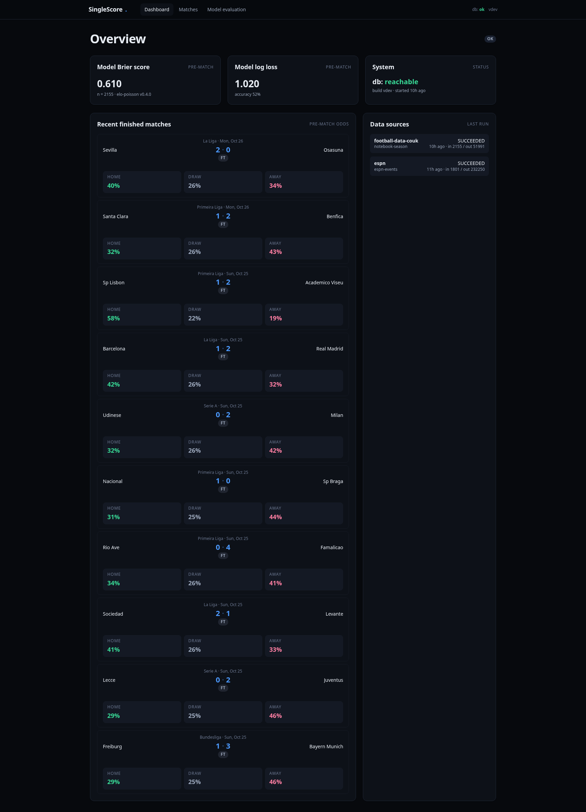
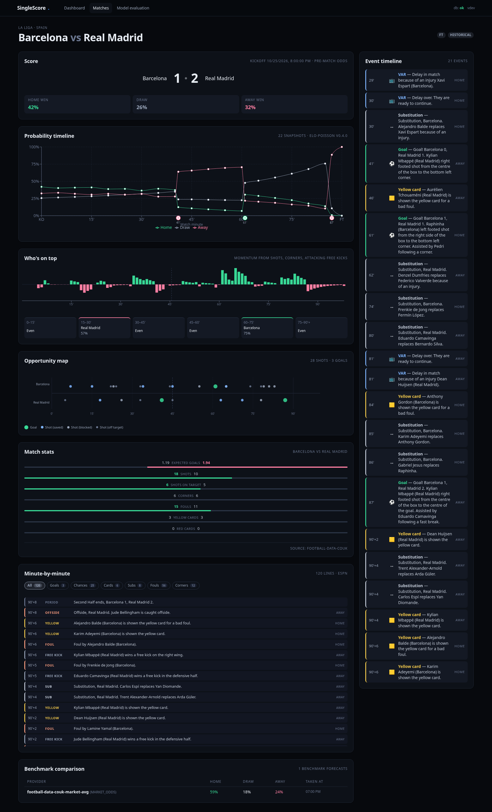
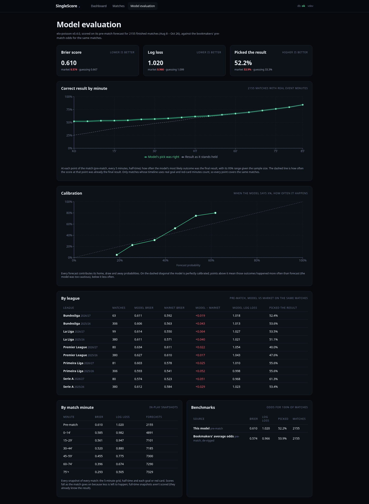

# SingleScore

Historical football prediction analytics MVP. Rebuilds each finished
match's win-probability timeline from its real events, compares the
pre-match forecast against market odds, and evaluates it against actual
outcomes. There is no live data: everything is loaded from completed
matches by hourly SingleStore notebooks.

Scope v1: top-flight only — **Primeira Liga** (Portugal), **Premier League**
(England), **Serie A** (Italy), **La Liga** (Spain), **Bundesliga**
(Germany). See `docs/data-sources.md`.

## Screenshots

**Overview**: recent finished matches with the pre-match home / draw / away
call, plus the status of the hourly ingest runs.



**Match detail**: Barcelona 1–2 Real Madrid. Score, probability timeline
rebuilt from the real minutes, "Who's on top" momentum, opportunity map,
match stats, minute-by-minute events and benchmark comparison.



**Model evaluation**: the model against bookmakers' pre-match odds and plain
guessing, across all finished matches.



## Stack

- **Database**: SingleStoreDB (MySQL-wire, v10.x). Rowstore for per-match
  tables, reference tables for the small lookup catalog.
- **Backend**: Go 1.26 + `gqlgen` GraphQL served via `net/http` (no
  third-party HTTP routers), `go-sql-driver/mysql` with TLS, `log/slog`
  JSON logs, Elo-based baseline predictor + evaluation (Brier, log-loss,
  calibration, bucketed by minute/competition).
- **Frontend**: React 18 + TypeScript + SCSS + Apollo Client + React
  Router 6 + Recharts, bundled with Webpack 5 + SWC (explicitly **not**
  Vite). Dark sports-analytics theme.
- **Testing**: Go unit tests for evaluation + predictor; Playwright e2e
  for Dashboard / Match detail / Evaluation.
- **Dev tooling**: SingleStore MCP (hosted; see `~/.cursor/mcp.json`),
  Figma MCP.

## Repository layout

```
SingleScore/
├── backend/                 Go GraphQL API
│   ├── cmd/
│   │   └── server/          main entry point
│   ├── internal/
│   │   ├── config/          env loading
│   │   ├── db/              SingleStore pool + health
│   │   ├── logging/         slog JSON wiring
│   │   ├── graph/           gqlgen schema, generated code, resolvers
│   │   ├── repository/      read-only SingleStore repositories
│   │   ├── service/         orchestration + repo→GraphQL mapping
│   │   ├── prediction/      Elo baseline predictor (+ unit tests), the
│   │   │                    reference the notebooks' Python port mirrors
│   │   └── evaluation/      Brier / log loss / calibration (+ unit tests)
│   ├── gqlgen.yml
│   └── go.mod
├── frontend/                React + TypeScript app
│   ├── public/              static index.html
│   ├── src/
│   │   ├── apollo/          client wiring
│   │   ├── components/      Nav, MatchRow, Chip, EmptyState
│   │   ├── graphql/         queries + hand-authored TS types
│   │   ├── pages/           Dashboard / Matches / MatchDetail / Evaluation
│   │   └── styles/          SCSS tokens + global
│   └── tests/               Playwright config + e2e specs
├── migrations/              numbered .sql files
├── notebooks/               hourly SingleStore ingest notebooks
├── scripts/                 db-apply.sh, db-shell.sh, notebook bodies as scripts
├── docs/
│   ├── architecture.md
│   ├── data-sources.md      (league scope + free-tier plan)
│   └── graphql.md
├── .env.example
└── README.md
```

## Prerequisites

- Go 1.26+ (installed under `~/.local/go/bin/go` on the dev machine)
- Node.js 20+ and npm 10+
- MySQL CLI (used to apply migrations)
- Access to the SingleStoreDB cluster whose credentials are in `.env`

## Running the stack locally

```bash
# 1) apply migrations once
./scripts/db-apply.sh

# 2) load the season (see "Data" below). On a fresh database run the CSV
#    ingest again after the ESPN scrape so the probability timelines are
#    rebuilt from the real goal / red-card minutes.
.venv/bin/python scripts/ingest_season.py
.venv/bin/python scripts/ingest_events_espn.py
.venv/bin/python scripts/ingest_season.py

# 3) start the backend (serves GraphQL on :8080)
cd backend && go run ./cmd/server
# or: go build -o /tmp/singlescore-backend ./cmd/server && /tmp/singlescore-backend

# 4) in another terminal, start the webpack dev server (proxies /graphql → :8080)
cd frontend && npm install && npm run dev
# → open http://127.0.0.1:3000
```

GraphQL endpoint: `POST http://127.0.0.1:8080/graphql`. The GraphQL
Playground is served at `GET http://127.0.0.1:8080/` when
`BACKEND_LOG_LEVEL=debug`.

### Playwright e2e

Headless Chromium smoke-tests for the Dashboard, Match detail, and
Evaluation pages:

```bash
cd frontend
npm run test:e2e:install   # first time only (~314 MB download)
npm run test:e2e           # requires backend + dev server running
```

### Running the baseline unit tests

```bash
cd backend && go test ./...
```

## Data

The app is **historical-only**: the backend is a read-only GraphQL API
and never calls a football data provider. Two hourly SingleStore
notebooks load the 2025/26 and 2026/27 seasons of the Premier League,
La Liga, Serie A, Bundesliga and Primeira Liga (2,155 matches as of this
writing) and tag every row `provenance = 'HISTORICAL'`:

- [`notebooks/season_ingest.ipynb`](notebooks/season_ingest.ipynb):
  football-data.co.uk CSVs (results, stats, pre-match odds), Elo per
  league, and the model's retrospective probability timelines.
- [`notebooks/events_espn.ipynb`](notebooks/events_espn.ipynb): exact
  goal / card / sub / VAR minutes and the minute-by-minute commentary,
  scraped from ESPN's public JSON (explicitly authorised by the project
  owner; not a licensed feed).

Both are generated from `scripts/` (`python3 scripts/build_notebooks.py`)
and run locally as plain scripts; see
[`notebooks/README.md`](notebooks/README.md) for what they write and how
to schedule them in the Portal.

Match lists, the dashboard and the match page's score card show the
model's **pre-match** odds. Later snapshots of a finished match converge
on the result (100% for the winner), so they say nothing about the
forecast. For the same reason the dashboard and the evaluation page score
the pre-match prediction, and full-time snapshots are never scored.

The Matches page filters by competition and by team name (case-insensitive
substring), with filters kept in the URL.

## Model honesty

- Predictions come from an internal, transparent model (`elo-poisson
  v0.4.0`): a Poisson race over the remaining playing time (stoppage time
  included) with Elo-driven scoring rates, home advantage, red cards that
  lower the carded side's rate and raise the opponent's, and a gentle tilt
  towards the side on top (weighted shots, corners, attacking free kicks
  and offsides over the last 15 minutes; the match page's "Who's on top"
  chart shows the same index). Elo ratings
  are seeded from the previous two seasons and updated on a 50/50 blend
  of goals and shot quality (shots on target ≈ 0.3 goals).
- `scripts/backtest_model.py` replays every match and scores each change
  separately on the earlier and later half of the matches. Over both stored
  seasons (2,155 matches) v0.4.0 cuts the pre-match Brier score from 0.633
  (v0.2.0) to 0.610 and the all-snapshot Brier from 0.493 to 0.478, and
  every step improves both halves. Tried and rejected because they didn't improve
  held-out matches: an in-match xG update of the scoring rates (built from
  the commentary's shot locations), stronger momentum tilts, and
  game-state effects.
- Nothing in the UI claims this model beats any benchmark.
- Every snapshot stores `(forecast_at, match_minute, home_score_at_fc,
  away_score_at_fc, model_version, provenance)` so evaluation is
  leakage-free.
- Benchmarks are the bookmakers' pre-match 1X2 odds (market average)
  from the CSV, de-vigged. They still beat the model (pre-match Brier
  0.574 vs 0.610 over both seasons). The odds are never used as a
  model input, so the comparison stays meaningful.

## Verified vs. pending

| Area                               | Status                                                |
| ---------------------------------- | ----------------------------------------------------- |
| Go toolchain                       | installed, 1.26.0                                     |
| SingleStore connectivity           | verified (hosted MCP + direct DML)                    |
| Migrations v1                      | applied (schema v1 live on the `singlescore` db)      |
| Backend scaffolding                | complete; `go build ./...` + `go vet ./...` clean     |
| GraphQL schema + resolvers         | complete; wired to repositories via the service layer |
| Repositories                       | complete, read-only (notebooks do all writes)         |
| Baseline predictor + unit tests    | complete; all tests green                             |
| Evaluation (Brier/log-loss/calib)  | complete; all tests green                             |
| Frontend scaffolding               | complete; `npm run typecheck` + `npm run build` clean |
| Dashboard + Match detail pages     | complete, rendering real GraphQL data                 |
| Model evaluation page              | complete, calibration/minute-bucket/competition views |
| Playwright e2e                     | 5 specs green against the running stack               |
| ESPN events + commentary scrape    | complete for all 5 leagues; `notebooks/events_espn.ipynb` + `scripts/ingest_events_espn.py`, 403/403 matches matched |
| football-data.co.uk CSV ingest     | complete for all 5 leagues; `notebooks/season_ingest.ipynb` + `scripts/ingest_season.py`, idempotent, ~10 s per run |
| Scheduled ingestion jobs           | **pending** — notebooks are ready; create the two hourly Jobs in the Portal (runs so far were local) |
| Figma designs                      | **pending** — using in-repo SCSS tokens for v1        |
